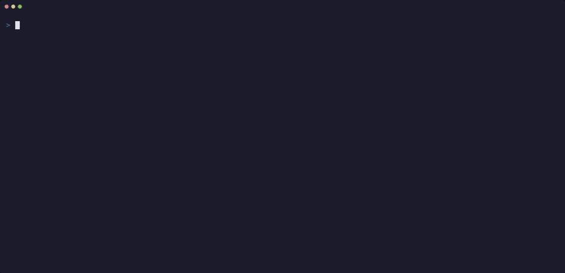

# gh-9s

A [k9s](https://k9scli.io)-style terminal UI for GitHub, as a `gh` extension.

- **Actions:** trigger workflows, watch runs as a live job graph, keep favorite workflows one keypress away.
- **Pull requests:** list and filter, see checks (and jump into the Actions run behind a check), read the diff, comment, review and merge.
- **Issues:** list and filter, read, comment, close and reopen, manage labels and assignees.
- **Discussions:** list by category, read with the replies under each comment, comment and reply.
- **Wiki:** read pages and follow their links, edit in your `$EDITOR`, add and delete pages (a wiki is a git repo, so each change is a commit).
- **Projects:** a board per Status column, move cards, mark several and change them at once, undo (every change asks first).
- **Repos:** an interactive picker to move between any repo you can reach.

## Motion

Screens push and pop sideways, tabs slide (and the highlighted tab slides along the strip), the selected row or card fades in, dialogs rise into place. It is all transient, so the screens stay as dense as before. Fades need a truecolor terminal; `GH9S_MOTION=off` turns every animation off.




## Demo

**Actions** — workflows, a failed run as a live job graph, its log, re-run the failed jobs:


**Pull requests** — checks, reviewers, a syntax-highlighted diff, the review question:


**Project boards** — move a card, undo, mark two cards and move both (every change asks first):


**Issues and everything else** — filter, read, jump between views, `?` for the keys of each screen:


The recordings use a pretend `gh` with made-up data (see [docs/demo](docs/demo)).

## Install

```sh
gh extension install MurabitoB/gh-9s
gh 9s                                  # run it inside any git repo with a GitHub remote
```

You need the [GitHub CLI](https://cli.github.com/) (`gh`), logged in. All GitHub access goes through it, so authentication, proxies and GitHub Enterprise follow whatever `gh` is logged in to (or `GH_HOST`). Enterprise has not been tested widely yet. A terminal 120 columns wide or more is best: it gets side-by-side diffs and a preview pane.

## A quick tour

| key / command | view |
|---|---|
| `1` / `:runs` | workflow runs; `enter` is the job graph, `l` the log |
| `2` / `:wf` | workflows; `t` triggers one with a form |
| `3` / `:pr` | pull requests; `enter` opens one, `d` the diff, `r` reviews, `m` merges |
| `4` / `:issues` | issues; `enter` opens one, `C` comments |
| `5` / `:discussions` | discussions; `c` picks a category, `r` replies to a comment |
| `6` / `:wiki` | wiki pages; `enter` reads, `e` edits, `n` adds a page, `x` deletes |
| `0` / `:inbox` | what needs you across all repos and hosts |
| `:fav` | favorites: workflows, pinned repos and pinned Projects (`enter` opens a board) |
| `:repo` | repo picker; `:repo OWNER/REPO` switches every view |
| `P` / `:cpr` | checks of the current branch's PR |

Everywhere: `j`/`k` move, `/` filter, `:` command bar, `esc` back, `R` refresh, `o` open in the browser, `q` quit. **`?` lists every key of the screen you are on**, and `:settings` lists the settings. Every change to GitHub asks first and names exactly what it will do.

## Documentation

Full guides and the key reference: **https://murabitob.github.io/gh-9s/**

[Runs and logs](https://murabitob.github.io/gh-9s/guides/runs-and-logs/) · [Job graph](https://murabitob.github.io/gh-9s/guides/job-graph/) · [Pull requests](https://murabitob.github.io/gh-9s/guides/pull-requests/) · [Reviewing a PR](https://murabitob.github.io/gh-9s/guides/reviewing-prs/) · [Issues](https://murabitob.github.io/gh-9s/guides/issues/) · [Discussions](https://murabitob.github.io/gh-9s/guides/discussions/) · [Wiki](https://murabitob.github.io/gh-9s/guides/wiki/) · [Project boards](https://murabitob.github.io/gh-9s/guides/projects/) · [Inbox](https://murabitob.github.io/gh-9s/guides/inbox/) · [Workflows and favorites](https://murabitob.github.io/gh-9s/guides/workflows/) · [Settings](https://murabitob.github.io/gh-9s/guides/settings/) · [All keys](https://murabitob.github.io/gh-9s/reference/keys/)

## Develop

```sh
mise install                          # pins go + gh (see mise.toml)
mise exec -- go build -o gh-9s .      # the binary must be named after the repo: gh-9s
gh extension install .                # then run: gh 9s
mise exec -- go test ./...
```

Pushing a `v*` tag publishes precompiled binaries via `.github/workflows/release.yml`.

```
main.go                 entry point (calls tui.Run)
internal/
  ghcli/                the only code that runs `gh` and `git` (runs, PRs, issues, discussions, wikis, Projects, repos, search)
  tui/                  Bubble Tea model, keys, screens (registered in screen.go), dialogs, and the glue
  workflow/, graph/     workflow YAML and the job dependency graph (pure, no network)
  diff/, markdown/, highlight/, termimg/   diff parser, Markdown renderer, syntax colours, inline images
  favorites/, pins/, recent/, drafts/, settings/   what is stored in your config directory
  ui/, icons/           colours, time formatting, icon sets
docs/                   specs and plans (docs/superpowers/), and the demo recordings (docs/demo/)
website/                the documentation site (Astro Starlight)
```

Only `ghcli` talks to GitHub; the rest is testable without a network, and the `tui` tests run with a stub `gh` first on `PATH`. A new screen registers itself in its own file. `.github/workflows/graph-demo.yml` is a manual-only workflow with matrix, skipped and `always()` jobs, for trying the job graph. The GIFs above are recorded with `docs/demo/record.sh` against a pretend `gh` (see `docs/demo/README.md`).
